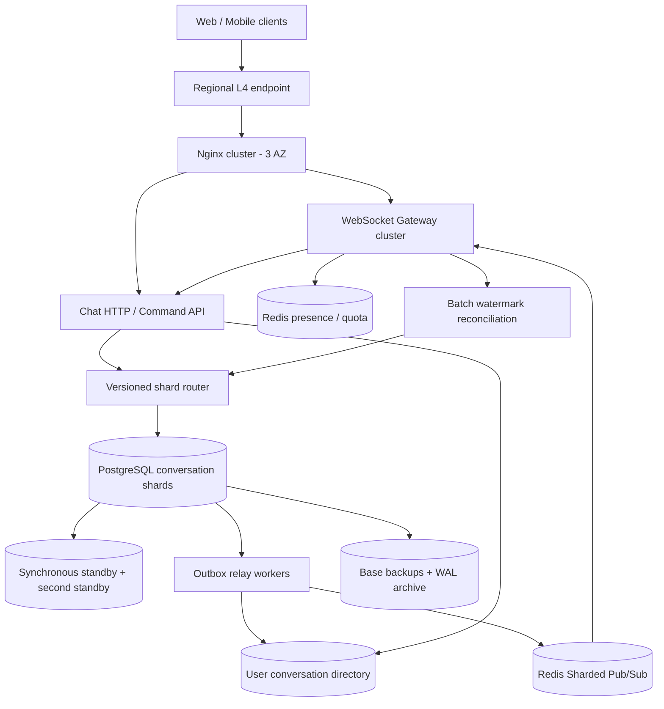
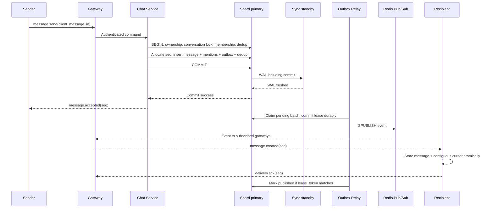
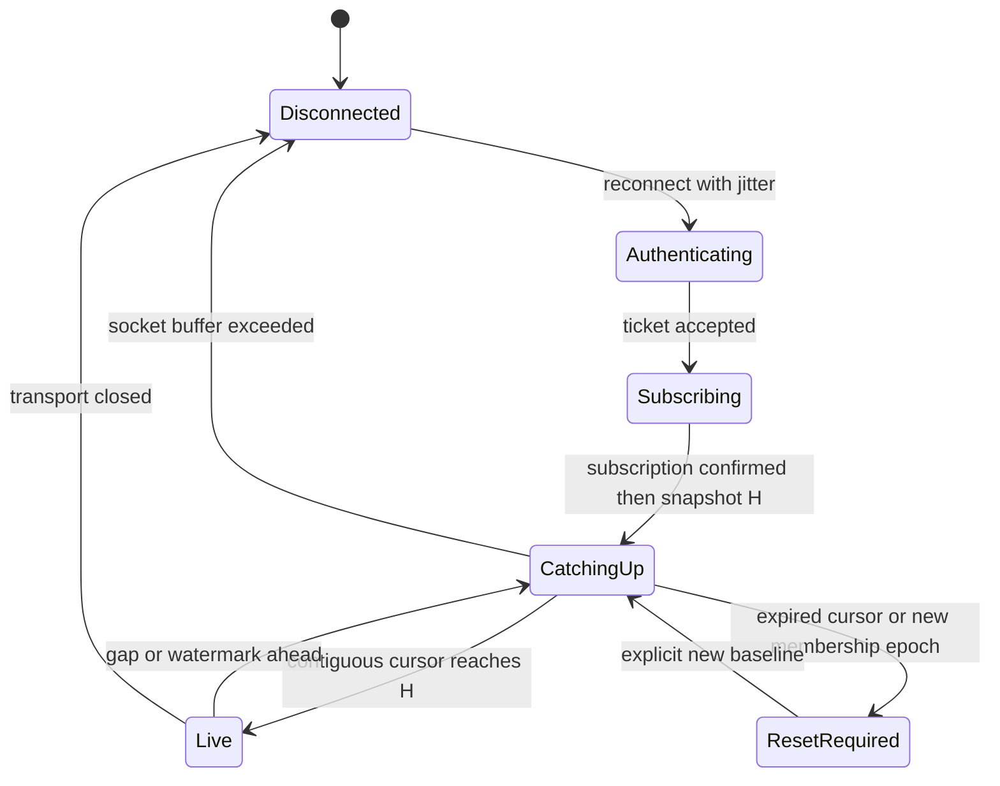

# Thiết kế Chat & Realtime Collaborative Notification Engine

**Trạng thái:** thiết kế tham chiếu, chưa triển khai hoặc đo tải. Ngày rà soát: 2026-10-12. Các mục tiêu dưới đây cần được chứng minh bằng [kế hoạch kiểm chứng](verification-plan.md). [Trang dự án](../README.md) liên kết các module nền tảng trong repo.

## 1. Yêu cầu, phạm vi và cam kết

### 1.1. Yêu cầu chức năng

| Khả năng | Quyết định v1 |
|---|---|
| Conversation | Chat 1–1; nhóm tối đa 100 thành viên đang hoạt động, tính cả người tạo |
| Message | Text UTF-8 tối đa 4 KiB; tối đa 10 mention/user IDs hợp lệ trong cùng nhóm; message bất biến |
| Multi-device | Tối đa 5 session/user; mỗi session có connection ID riêng, mỗi cài đặt có device ID |
| History | 365 ngày truy cập được; cursor pagination; không dùng offset |
| Quyền lịch sử | Từ lần join hiện tại; rejoin tạo epoch mới, không khôi phục lịch sử lần join cũ |
| Notification | Message mới, mention theo conversation, unread, delivered/read, typing và presence |
| Offline/reconnect | Đọc bù message còn trong retention, kiểm tra lại quyền hiện tại |
| Ngoài phạm vi | Push/email, attachment, search toàn văn, edit/delete, reaction, thread, global notification inbox, E2EE, multi-region active-active |

Đây là engine cho một miền ứng dụng. Authentication dựa trên identity provider hiện có; thiết kế không xây hệ thống tài khoản. UUID của user được identity provider ánh xạ ổn định. Không giả định một connection tương đương một user.

### 1.2. Workload và SLO

| Đại lượng | Giá trị / cách đo |
|---|---|
| WebSocket đồng thời | 100.000 connection đang authenticated |
| Tốc độ message | 5.000 message **mới**/s liên tục; retry không tính là message mới |
| Burst kiểm thử | 10.000 message/s trong 60 giây, hoặc admission control rõ ràng |
| Ordering | Theo conversation, không có total order giữa conversation |
| Availability | 99,9%/tháng cho thao tác hợp lệ trong workload đã công bố |
| Accepted latency | p99 ≤ 200 ms từ Gateway nhận đủ frame tới enqueue ACK, cùng region |
| Realtime latency | p99 ≤ 500 ms từ Gateway nhận send tới thiết bị online ACK delivery, RTT thử nghiệm ≤ 50 ms |
| History latency | p99 ≤ 300 ms cho page ≤ 100 message, cùng region |
| Phục hồi message bị lỡ | p99 ≤ 35 giây sau khi dependency khỏe, cho client đang online và không bị backpressure |
| Presence | TTL 30 giây; mục tiêu phản ánh offline ≤ 40 giây sau heartbeat cuối khi hệ thống khỏe |
| HA | RPO = 0 cho dữ liệu đã ACK khi mất một máy hoặc một AZ; RTO mục tiêu ≤ 120 giây |

SLO latency steady state đo riêng với khoảng failover; lỗi failover vẫn tính vào availability. Request hợp lệ bị từ chối do thiếu capacity tính là availability failure; vi phạm quota công bố là kết quả riêng. Recipient offline không tham gia mẫu realtime latency; phải công bố số recipient được loại cùng lý do. Presence và typing không có durability SLO.

### 1.3. Những điều phải luôn đúng

1. `message.accepted` chỉ được phát khi message và outbox đã bền vững qua ACK boundary ở mục 7.
2. Một `(conversation_id, sender_id, client_message_id)` chỉ tạo một message. Retry trả cùng sequence; payload khác trả conflict.
3. `seq` tăng liên tục cho message đã commit trong từng conversation; rollback không tiêu thụ sequence. Membership, typing, receipt không tiêu thụ sequence message.
4. Client chỉ tiến delivery cursor qua đoạn message đã lưu liên tục; nhận `seq=105` không tự xác nhận đã nhận `104`.
5. Delivery qua mạng có thể lặp. Unique local key và transaction lưu cursor tạo hiệu ứng hiển thị một lần trên client tuân thủ giao thức.
6. Quyền đọc là giao của membership hiện tại, mốc join và retention. Cursor không cấp quyền truy cập.

RPO = 0 không áp dụng khi mất cả region, mất mọi bản sao, lỗi logic xóa dữ liệu hoặc operator cố tình promote replica không an toàn. Không sử dụng Redis lock hoặc Redis presence làm căn cứ xác định primary database.

## 2. Capacity planning

### 2.1. Lưu trữ

Giả định message trung bình gồm text và envelope lưu trữ là **1 KiB = 1.024 byte**; đây không phải kích thước tối đa. Đơn vị TB/PB dưới đây là thập phân. Một năm tính 365 ngày.

```text
messages/day  = 5.000 × 86.400             = 432.000.000
messages/year = 432.000.000 × 365         = 157.680.000.000
raw/day       = 432.000.000 × 1.024       = 442,368 GB
raw/year      = 157.680.000.000 × 1.024    = 161,46432 TB ≈ 146,85 TiB
```

| Thành phần | Giả định tính ngân sách | Dung lượng toàn hệ thống |
|---|---|---:|
| Message + metadata + indexes | Raw × 1,5; phải đo bằng dữ liệu thật | 242,20 TB / 365 ngày / một bản |
| Dedup ledger và indexes | 256 byte/message, giữ riêng khỏi message partitions | 40,37 TB / 365 ngày / một bản |
| Trần lưu vật lý | Nhân 396/365 cho monthly retention và dedup cleanup | 306,56 TB / một bản |
| Primary + 2 standby | Ba bản, không tính storage RAID nội bộ | 919,68 TB |
| Provision ở mức dùng 65% | 919,68 / 0,65 | 1.414,90 TB ≈ 1,415 PB |

35% trống dành cho WAL, compaction/vacuum, reshard tạm thời, outbox và biến động payload. Không tính backup vào ba bản replication. Với lịch base backup hàng tuần và retention 42 ngày để hỗ trợ PITR 35 ngày, dự trù bảy bộ base backup tại thời điểm giao lịch, trước compression/dedup: khoảng 2.145,93 TB với trần một bản. Cộng WAL archive và một restore target bằng shard lớn nhất. Retained old backups có thể còn dữ liệu đã hết 365 ngày; quyền truy cập và lịch xóa backup phải tách khỏi API retention.

WAL amplification chưa biết trước. Với giả định minh họa 3× raw ingest, WAL khoảng 1,33 TB/ngày; archive 42 ngày khoảng 55,74 TB. Phải đo cả outbox, dedup cleanup, read receipts và visibility barrier; số 3× không phải giới hạn trên.

Outbox outage 24 giờ tạo 432 triệu event nếu một event/message. Với 1,5 KiB/event gồm index/overhead là khoảng 663,55 GB/một bản. Pending event không được TTL xóa; giảm admission trước khi hết disk. Event đã phát được dọn theo batch sau một giờ; `published` không có nghĩa recipient đã nhận.

### 2.2. Network, fan-out và connection

Fixture cơ sở: 70% message thuộc DM, 30% thuộc nhóm; nhóm trung bình 20 người, 30% recipient online, 1,2 session/online user. Tính thêm một echo tới session gửi và bình quân 0,2 session khác của sender:

```text
recipient-other-user-sessions/message
  = (0,7 × 1 + 0,3 × 19) × 0,3 × 1,2 = 2,304
deliveries/message ≈ 2,304 + 1,2 = 3,504
deliveries/s       ≈ 17.520
payload egress     ≈ 17,94 MB/s ≈ 143,52 Mb/s
```

Đây chỉ là fixture capacity; phải chạy riêng all-online và all-group workloads. Trường hợp 5.000 message/s đều tới nhóm 100 người online, 1 session/người: 500.000 deliveries/s, khoảng 512 MB/s hoặc 4,096 Gb/s payload. Hai session/người tăng gấp đôi. Chưa cộng WebSocket/TLS/IP overhead, ACK, history và traffic nội bộ.

100.000 connection / 10 giây tương đương 10.000 heartbeat/s. Lua presence script có nhiều Redis operations, không thể gọi đây là chỉ 10.000 Redis commands/s. Mỗi connection giả định 64 KiB cho socket/TLS/application state cho tổng khoảng 6,55 GB; chưa gồm kernel buffers, subscription maps, runtime heap và queue.

Worst-case queue cap 256 KiB/socket trên 100.000 socket đã là 26,21 GB. Vì vậy có cả budget theo socket **và theo node**, không cấp phát cap cho mọi socket từ đầu. Nginx reverse proxy dùng xấp xỉ hai socket FD/connection (client và upstream); connection đến backend không tự biến mất khỏi ngân sách FD.

### 2.3. Topology khởi điểm để kiểm chứng

| Lớp | Đề xuất ban đầu | Lý do và giới hạn |
|---|---|---|
| L4 entry + Nginx | Managed regional L4, 6 Nginx instances, 2/AZ; 8 vCPU, 16 GiB/instance | Mất AZ còn 4 instances; kiểm tra FD, upstream ports và băng thông |
| Gateway | 12 instances, 4/AZ; 8 vCPU, 16 GiB; target 12.500, cap 15.000 sockets/node | Bình thường ~8.333/node; mất AZ còn 8 node × 12.500 = 100.000 |
| Chat API | 12 instances, 4/AZ; 8 vCPU, 16 GiB; scale độc lập Gateway | CPU, DB pool và fan-out là tiêu chí scale, không chỉ QPS |
| Message storage | 32 physical shards × 3 replicas; 32 vCPU, 128 GiB, 16 TB usable/replica | 96 database nodes, 1,536 PB provision; storage là động lực chính |
| Redis backplane | Cluster 3 primaries + 3 replicas, replica khác AZ; 8 vCPU, 16 GiB/node | Redis 7+ sharded Pub/Sub; phải đo pubsub buffers/network |
| Redis presence/quota | Cluster riêng 3 primaries + 3 replicas, 8 vCPU, 16 GiB/node | Cô lập heartbeat/quota khỏi fan-out; dữ liệu presence có thể tái tạo |
| Directory metadata | Một PostgreSQL HA group ba AZ, 8 vCPU, 32 GiB; storage theo membership thực đo | Chứa index user → conversation; không chứa message bodies |
| Điều phối HA/routing | 3 etcd members, mỗi AZ một member; Patroni quản lý PostgreSQL | Chỉ control plane; không đọc etcd cho mỗi message |

Mỗi message shard trung bình 156,25 new message/s và khoảng 9,58 TB dữ liệu/replica ở trần lưu vật lý. Throughput thực còn có indexes, outbox, replay và WAL; phân bố không bao giờ hoàn toàn đều. 32 shard không phải yêu cầu để chịu 5.000 write/s, mà là sizing ban đầu cho lượng lưu một năm. Bắt đầu ít shard ở môi trường nhỏ và dùng cùng routing protocol; không tuyên bố một lab laptop đại diện topology này.

Scale khi CPU > 60%, NIC > 60%, queue delay tăng hoặc connections > target trong 10 phút; scale trước khi dùng hết headroom mất AZ. Database thêm capacity ở 60% disk, không đợi 90%. Hội thoại nóng vẫn chỉ có một ordering lane: giới hạn ban đầu 50 new message/s/conversation, burst 100; mục tiêu này phải được kiểm chứng với synchronous commit latency. Nâng giới hạn đòi hỏi batching/sequencer được review lại.

## 3. Kiến trúc tổng thể và data flow



Các khối biểu diễn trách nhiệm. Chat HTTP/command handler có thể cùng codebase/process lúc đầu; Gateway cần scale/drain độc lập. Relay không được chạy trên event loop phục vụ socket nếu công việc backlog làm nghẽn connection.

### 3.1. Subscription và fan-out

Gateway duy trì `user → sessions`, `conversation → authorized local sessions` và refcount subscription. Với Redis 7+, dùng `SSUBSCRIBE chat:v1:conv:{conversation_id}` và `SPUBLISH` vào cùng shard channel. Chỉ subscribe khi có local session cần theo dõi; bỏ subscription khi refcount về 0. Không dùng broadcast mọi message tới mọi app node. Redis mô tả sharded Pub/Sub để giới hạn lan truyền cluster bus; nó vẫn có semantics at-most-once. [Nguồn Redis](https://redis.io/docs/latest/develop/pubsub/).

V1 giới hạn 200 active conversations/user. Gateway theo dõi cả conversations không mở để cập nhật unread; typing/presence chỉ theo dõi conversation đang xem. Worst case 100.000 × 200 = 20 triệu session-conversation associations; cần đo heap của map/index, không chỉ socket. Tại fixture bình quân 20 conversations/session là 2 triệu associations trước dedup theo node.

Message event được publish một lần/conversation; Redis giao một bản tới mỗi Gateway đang subscribe, Gateway nhân bản tới sessions tại node. Nhiều relay có thể phát trễ/đảo thứ tự: thứ tự hiển thị lấy từ `seq`, không từ thứ tự callback Redis. Khi cần lấp gap, Gateway dùng single-flight theo conversation để nhiều local sessions chia sẻ page đọc và vẫn áp dụng quyền riêng.

### 3.2. Khám phá conversation sau reconnect

Directory chứa `(user_id, conversation_id, membership_epoch, active, membership_version)`, index `(user_id, conversation_id)`. Đây là projection để tìm conversation, không cấp quyền. Chỉ membership events cập nhật directory; message thông thường không fan-out write tới directory.

Membership transaction trên conversation shard ghi outbox chứa snapshot membership mới. Relay gọi directory bằng idempotent upsert chỉ nhận `membership_version` lớn hơn; **đợi directory commit bền vững trước khi hoàn tất event**, sau đó publish invalidation. Lỗi giữa hai bước chỉ gây retry. Phiên bản leave/rejoin đến trễ không được làm sống lại membership cũ.

Mỗi session tải directory khi connect và đối soát theo chu kỳ ngẫu nhiên 24–30 giây. Sau đó batch kiểm tra membership và watermark ở các shard. Directory có thể trễ: thêm thành viên trả `membership_epoch` và conversation ID cho người thao tác; người được thêm sẽ thấy trong chu kỳ đối soát sau khi projection bắt kịp. Mục tiêu projection lag ≤ 5 giây, discovery ≤ 35 giây khi dependency khỏe. Không cam kết liệt kê tức thời khi directory bị outage.

Nếu directory lỗi, session còn local conversation list vẫn có thể sync từng conversation đã biết sau authorization. Thiết bị mới nhận `DIRECTORY_UNAVAILABLE` có retry; không trả danh sách rỗng như thể user không thuộc nhóm nào. Rebuild directory bằng snapshot membership các shard cộng outbox catch-up; thực hiện version-aware upsert.

## 4. Schema và sharding

### 4.1. Routing

`bucket = uint64_be(SHA-256(canonical_uuid_bytes(conversation_id))[0:8]) % 4096`. Đây là 4.096 logical buckets cố định; bảng ánh xạ trả `owner_shard`, `routing_epoch`, `state`. Hash phải có test vector liên ngôn ngữ; không dùng runtime hash ngẫu nhiên.

Test vectors trên 16 UUID bytes theo network order, không hash chuỗi có dấu gạch: `00000000-0000-0000-0000-000000000001 → 891`; `018f0000-0000-7000-8000-000000000001 → 1780` với modulus 4096.

Router cache bản đồ; mỗi DB transaction kiểm tra local ownership epoch dưới shared advisory transaction lock theo bucket. Cutover lấy exclusive lock cùng key trước khi chuyển ownership. App role chỉ được gọi write functions kiểm tra ownership; không cho đường INSERT bỏ qua router. Client không gửi physical shard ID. Old routing nhận `STALE_ROUTE`, refresh map và retry cùng idempotency key; nếu đang freeze thì trả lỗi retryable.

### 4.2. Schema tham chiếu trên từng conversation shard

SQL dùng PostgreSQL 16 để khớp giáo trình; đây là DDL minh họa cấu trúc, chưa phải migration có roles/triggers/partition scheduler. Unique sequence xuyên tháng được bảo vệ bởi transaction cấp sequence và ledger; không giả vờ rằng PK có partition key là global unique theo conversation.

```sql
CREATE TABLE conversations (
    conversation_id uuid PRIMARY KEY,
    kind text NOT NULL CHECK (kind IN ('dm', 'group')),
    last_seq bigint NOT NULL DEFAULT 0 CHECK (last_seq >= 0),
    last_created_at timestamptz,
    membership_version bigint NOT NULL DEFAULT 1,
    member_count integer NOT NULL CHECK (member_count BETWEEN 1 AND 100)
);

CREATE TABLE memberships (
    conversation_id uuid NOT NULL REFERENCES conversations,
    user_id uuid NOT NULL,
    epoch uuid NOT NULL,
    active boolean NOT NULL,
    role text NOT NULL CHECK (role IN ('owner', 'member')),
    joined_seq bigint NOT NULL CHECK (joined_seq >= 1),
    read_seq bigint NOT NULL CHECK (read_seq >= 0),
    delivered_seq bigint NOT NULL CHECK (delivered_seq >= 0),
    PRIMARY KEY (conversation_id, user_id)
);
CREATE INDEX memberships_by_user ON memberships (user_id, conversation_id);
CREATE UNIQUE INDEX one_active_owner ON memberships (conversation_id)
    WHERE active AND role = 'owner';

CREATE TABLE messages (
    conversation_id uuid NOT NULL REFERENCES conversations,
    seq bigint NOT NULL CHECK (seq > 0),
    created_at timestamptz NOT NULL,
    sender_id uuid NOT NULL,
    client_message_id uuid NOT NULL,
    body text NOT NULL CHECK (octet_length(body) BETWEEN 1 AND 4096),
    PRIMARY KEY (conversation_id, seq, created_at)
) PARTITION BY RANGE (created_at);

CREATE TABLE messages_2026_10 PARTITION OF messages
    FOR VALUES FROM ('2026-10-01 00:00:00+00')
                 TO ('2026-11-01 00:00:00+00');

CREATE TABLE message_dedup (
    conversation_id uuid NOT NULL REFERENCES conversations,
    sender_id uuid NOT NULL,
    client_message_id uuid NOT NULL,
    payload_hash bytea NOT NULL,
    seq bigint NOT NULL,
    message_created_at timestamptz NOT NULL,
    expires_at timestamptz NOT NULL,
    PRIMARY KEY (conversation_id, sender_id, client_message_id),
    UNIQUE (conversation_id, seq)
);
CREATE INDEX dedup_expiry ON message_dedup (expires_at);

CREATE TABLE conversation_months (
    conversation_id uuid NOT NULL REFERENCES conversations,
    month_start date NOT NULL,
    min_seq bigint NOT NULL,
    max_seq bigint NOT NULL,
    PRIMARY KEY (conversation_id, month_start),
    CHECK (min_seq <= max_seq)
);

CREATE TABLE device_delivery (
    conversation_id uuid NOT NULL REFERENCES conversations,
    user_id uuid NOT NULL,
    device_id uuid NOT NULL,
    membership_epoch uuid NOT NULL,
    delivered_seq bigint NOT NULL,
    updated_at timestamptz NOT NULL,
    PRIMARY KEY (conversation_id, user_id, device_id)
);

CREATE TABLE message_mentions (
    conversation_id uuid NOT NULL,
    recipient_id uuid NOT NULL,
    recipient_epoch uuid NOT NULL,
    seq bigint NOT NULL,
    message_created_at timestamptz NOT NULL,
    PRIMARY KEY (conversation_id, recipient_id, seq, message_created_at)
) PARTITION BY RANGE (message_created_at);

CREATE TABLE message_mentions_2026_10 PARTITION OF message_mentions
    FOR VALUES FROM ('2026-10-01 00:00:00+00')
                 TO ('2026-11-01 00:00:00+00');

CREATE TABLE outbox (
    event_id uuid PRIMARY KEY,
    conversation_id uuid NOT NULL REFERENCES conversations,
    event_type text NOT NULL,
    payload jsonb NOT NULL,
    created_at timestamptz NOT NULL,
    available_at timestamptz NOT NULL,
    lease_token uuid,
    lease_until timestamptz,
    attempts integer NOT NULL DEFAULT 0,
    quarantined_at timestamptz,
    last_error text,
    published_at timestamptz
);
CREATE INDEX outbox_pending ON outbox (available_at, created_at)
    WHERE published_at IS NULL AND quarantined_at IS NULL;

CREATE TABLE durability_barriers (
    lane_id uuid PRIMARY KEY,
    generation bigint NOT NULL DEFAULT 0
);
```

Mỗi logical worker trong app DB pool thực hiện visibility barrier có lane UUID riêng, tạo khi pool khởi tạo và tái sử dụng tuần tự; không tạo một row/request hoặc phụ thuộc backend PID qua PgBouncer. Bảng routing ownership nằm trên từng shard và metadata directory nằm ở DB riêng như mô tả trên; không có foreign key xuyên shard.

`message_dedup` có thể chia hash partition theo `conversation_id` khi triển khai vì cả hai unique keys đều chứa partition key; không chia range theo thời gian commit. Giữ dedup 396 ngày từ lúc nhận ID lần đầu và dọn bằng batch theo `expires_at`; tỷ lệ heap/index/vacuum phải benchmark. Message ID công khai là cặp `(conversation_id, seq)`; UUID event ID dành cho outbox.

### 4.3. Retention, index và phân trang

Message partition theo tháng UTC; tạo trước hai tháng và cảnh báo khi còn dưới một tháng. API lọc `created_at >= server_now - interval '365 days'`. Chỉ detach/drop partition có upper bound không lớn hơn cutoff; vật lý có thể còn tới dưới 396 ngày, trong khi API chỉ phục vụ 365 ngày. Retention không phải cam kết xóa vật lý chính xác tại giây thứ 365 ngày.

Khi cấp message mới, `created_at = max(clock_timestamp(), last_created_at)` dưới conversation row lock. Timestamp không giảm trong một conversation; sequence vẫn là ordering authority. `conversation_months` cập nhật trong cùng transaction và giúp tìm tháng chứa sequence, bỏ qua tháng không có tin. Query tháng liên tiếp cho tới đủ page, không scan hàng triệu row để bỏ qua offset. PK `(conversation_id, seq, created_at)` hỗ trợ range scan theo conversation và seq trong partition. PostgreSQL yêu cầu unique constraint trên partitioned table chứa partition key. [Nguồn partitioning](https://www.postgresql.org/docs/16/ddl-partitioning.html).

Ví dụ một page lịch sử trong tháng đã được server chọn; `$1..$6` là parameters, không nối tên bảng từ input:

```sql
SELECT conversation_id, seq, created_at, sender_id, client_message_id, body
FROM messages
WHERE conversation_id = $1
  AND seq < $2
  AND seq >= $3
  AND created_at >= $4
  AND created_at >= $5 AND created_at < $6
ORDER BY seq DESC
LIMIT 100;
```

`$3` là join floor; `$4` là retention cutoff; `$5/$6` là tháng UTC do server xác định. Replay thay `<` bằng `>` trên cursor, thêm `seq <= high_watermark`, đọc `ASC`. Dùng `limit + 1` khi cần xác định `has_more`. Trang không có cursor lấy `last_seq + 1` cho history; trả items tăng dần để UI ghép thống nhất.

Retention có thể tiến khi người dùng đang phân trang. Server trả `earliest_available_seq` mới; không âm thầm coi khoảng bị xóa là đã delivered. Không có edit/delete message ở v1 nên sau join/retention floor, committed message sequence không có lỗ nội bộ. Metadata tháng cũ chỉ xóa sau detach thành công; nếu không còn message, earliest được đặt `last_seq + 1`.

### 4.4. Membership và tạo conversation

Tạo group nhận danh sách user đã xác thực tồn tại; creator là owner, tối đa 100 IDs khác nhau. Tạo DM nhận đúng hai user IDs; v1 cho phép hai người có nhiều DM conversation, không đòi global unique theo cặp user. Client tạo `conversation_id` UUIDv7 trước lần gửi đầu, retry cùng ID; server so sánh creator và payload hash trong creation receipt bền vững trên shard để ngăn tạo trùng hoặc đổi payload.

Thêm/bớt thành viên phải khóa conversation cùng thứ tự với gửi message. Join lấy `joined_seq = last_seq + 1`, `read_seq = delivered_seq = last_seq`, epoch mới. Owner được add/remove; user được leave; không cho owner leave trước khi chuyển quyền qua `PATCH member role`. Chỉ một owner tại một thời điểm, chuyển quyền cùng transaction: hạ owner cũ rồi nâng owner mới để không vi phạm unique index. DM không cho thay thành viên. Cap 200 active conversations/user được Directory giữ slot bằng reservation có idempotency key trước khi join; transaction shard commit thất bại thì worker giải phóng reservation sau khi xác minh kết quả. Reservation chưa rõ kết quả không TTL tự giải phóng để tránh vượt cap; reconciler truy vấn shard. Thao tác membership fail closed nếu Directory không sẵn sàng, còn chat trong nhóm đã có vẫn hoạt động.

Leave giữ membership tombstone, tăng `membership_version`, inactive và ghi outbox. Rejoin thay epoch/join floor/read state; delivery ACK epoch cũ bị từ chối. Cap nhóm kiểm tra dưới cùng row lock nên hai add đồng thời không vượt 100. Authorization snapshot có version/expiry như mục 10; directory và Pub/Sub invalidation chỉ giúp cập nhật nhanh hơn.

Directory reservation có trạng thái `RESERVED → ACTIVE → RELEASED` và unique key `(user_id, conversation_id, operation_id)`. Khi outcome join chưa rõ, reconciler lấy cùng conversation lock với mutation, đọc operation receipt; nếu chưa commit thì ghi receipt `ABORTED` bền vững trước khi release slot. Late retry nhìn thấy ABORTED phải dừng, không được join sau khi slot đã giải phóng. Creation dùng advisory transaction lock theo conversation ID trước khi row tồn tại. Directory consumer biến đúng reservation thành ACTIVE khi nhận committed membership event; leave giải phóng đúng epoch, không giải phóng slot của lần rejoin mới.

Directory khóa quota row theo user khi reserve, đếm cả RESERVED và ACTIVE, và chỉ cho một live slot trên `(user_id, conversation_id)`. Request add user đã active là no-op, không giữ thêm slot. Create nhiều thành viên reserve theo thứ tự user UUID cố định; nếu không đủ quota thì hủy cả operation bằng receipt trước khi release các slots đã giữ.

## 5. Hợp đồng HTTP và WebSocket

### 5.1. HTTP

Mọi API dùng TLS, authenticated user từ token; không tin `sender_id` trong body. UUID hiển thị đầy đủ trong implementation; ví dụ `c1/u1/d1/e1` dưới đây là ký hiệu rút gọn. `seq`, watermark và bigint được truyền bằng **chuỗi thập phân**, không ép qua JavaScript Number.

| Endpoint | Contract chính |
|---|---|
| `POST /v1/ws-tickets` | Token authenticated → ticket một lần, TTL 30 giây, ràng buộc user/device/Origin |
| `GET /v1/ws` | WebSocket upgrade, xác thực ticket qua subprotocol; trả `session.ready` |
| `POST /v1/conversations` | `{conversation_id, kind, member_ids}`; 201 khi tạo, 200 khi retry giống; creator lấy từ auth |
| `GET /v1/conversations?cursor=...&limit=50` | Directory pagination theo conversation ID, limit tối đa 100; version từng membership; không offset |
| `POST /v1/conversations/{id}/members` | Owner thêm `{user_id, operation_id}`; replay cùng operation ID không join lần nữa |
| `DELETE /v1/conversations/{id}/members/{user_id}` | Leave/remove idempotent; `If-Membership-Epoch` bắt buộc để retry cũ không xóa lần rejoin mới |
| `PATCH /v1/conversations/{id}/members/{user_id}` | Chuyển owner có expected membership version; conflict nếu version đã đổi |
| `GET /v1/conversations/{id}/messages?before=...&limit=100` | Lịch sử, exclusive before; không cursor thì newest page |
| `GET /v1/conversations/{id}/messages?after=...&until=...&limit=100` | Replay exclusive after, inclusive snapshot H; không kết hợp before và after |
| `GET /v1/conversations/{id}/mentions?after=...&limit=100` | Mention của authenticated user/epoch; cursor riêng cho tập kết quả thưa |
| `GET /v1/conversations/{id}/receipts` | Snapshot read và aggregate delivered theo member/epoch; version từng cursor |
| `POST /v1/sync/watermarks` | Tối đa 100 conversation IDs/batch; trả H, retention floor, membership epoch và read state |
| `POST /v1/presence/query` | Tối đa 100 user IDs có quan hệ conversation hợp lệ; online/offline/unknown |

Mutation membership lưu operation receipt cùng shard transaction, khóa `(conversation_id, actor_id, operation_id)`, hash payload và kết quả epoch/version. Giữ receipt 396 ngày; operation ID UUIDv7 có cùng chính sách tuổi như send. Creation receipt giữ cùng tuổi đời conversation, chỉ creator được truy vấn lại. Schema receipt là `(key columns, payload_hash, result_json, created_at, expires_at)`; không dùng cache làm nguồn idempotency.

History response:

```json
{
  "conversation_id": "c1",
  "membership_epoch": "e1",
  "items": [{"seq": "104", "sender_id": "u1", "body": "Chào nhóm", "created_at": "2026-10-12T10:00:00Z"}],
  "next_cursor": "opaque-signed-cursor",
  "has_more": false,
  "high_watermark": "104",
  "earliest_available_seq": "80"
}
```

Cursor là base64url payload + HMAC-SHA256 có `key_id`; payload chứa version, mode, conversation, membership epoch, sequence exclusive boundary và snapshot H khi replay. Directory cursor có user scope; mention cursor có recipient scope. Key ký giữ đủ 396 ngày để resume dài hạn; khi bắt buộc thu hồi key trả `CURSOR_INVALID` và đi vào reset có thông báo. Không đặt routing epoch trong cursor: reshard không được làm hỏng cursor nghiệp vụ. Server xác minh mode, chữ ký, ID scope và quyền mỗi request; không nhận `until` trần do client tự tăng.

### 5.2. WebSocket envelope

```json
{
  "v": 1,
  "type": "message.send",
  "request_id": "uuid-per-attempt",
  "conversation_id": "c1",
  "data": {
    "client_message_id": "uuidv7-stable-across-retries",
    "body": "Chào nhóm",
    "mention_user_ids": ["u2"]
  }
}
```

`request_id` nối request/response từng attempt; `client_message_id` giữ nguyên cho một ý định gửi. Server canonicalize UTF-8 body chính xác và danh sách mention sorted/deduplicated để tính SHA-256 payload hash. Không normalize nội dung text theo cách làm hai payload khác nhau bị coi là một. Frame tối đa 16 KiB, JSON depth tối đa 8, không nhận field auth/role từ client.

| Event | Ý nghĩa và dữ liệu tối thiểu |
|---|---|
| `session.ready` | `session_id`, heartbeat 10 giây, server time, protocol version |
| `message.accepted` | Cùng request/client ID, conversation, seq, created_at, `deduplicated`; đã qua durability boundary |
| `message.created` | `event_id`, conversation, seq, sender, `client_message_id`, body, mentions, created_at, epoch và resume token cho recipient |
| `delivery.ack` | Conversation, current membership epoch, device ID lấy từ session, highest contiguous seq đã lưu |
| `delivery.updated` | Recipient user, max delivered seq và epoch; chỉ trong conversation được phép |
| `read.update` / `read.updated` | Cursor read theo user/epoch; monotonic, không lớn hơn H đã cấp |
| `sync.resume` | Tối đa 50 `{conversation_id, cursor}`/frame; cursor là local persisted cursor, không phải receipt của thiết bị khác |
| `sync.begin` | Current epoch, H và earliest available; bắt đầu replay theo snapshot |
| `sync.complete` | Hoàn tất gửi snapshot tới H; client vẫn phải lưu và ACK trước khi coi là delivered |
| `sync.required` | Buffer overflow, invalid epoch hoặc gap; nêu reason, không xóa local data tự động |
| `heartbeat` / `heartbeat.ack` | Session generation, nonce, server time; dùng application frame cho cả browser |
| `typing.update` / `typing.changed` | Start/stop, TTL 5 giây; tối đa 1 update/s/user/conversation |
| `presence.changed` | User, online/offline/unknown, observation time; không chứa device IDs của người khác |
| `error` | Request ID, code, retryable, retry_after_ms nếu có |

Client gửi `delivery.ack` ngay sau local commit hoặc gộp tối đa 50 ms; server coalesce các durable receipt writes và broadcasts mỗi 1 giây. Ghi `GREATEST(old, new)` theo epoch vào device cursor và `memberships.delivered_seq` aggregate trong cùng transaction. Aggregate không giảm khi một device cũ bị dọn; rejoin reset theo epoch mới. Sender thấy delivered khi ít nhất một device của recipient ACK; group receipt trả danh sách tối đa 100 members, không gọi một boolean duy nhất là “cả nhóm đã nhận”. ACK delivery/read từ server chỉ phát sau commit; nếu server crash trước flush, client gửi lại cursor đã lưu khi reconnect.

Gateway giữ highest contiguous sequence đã cung cấp cho session (bắt đầu từ resume token hợp lệ) và từ chối `delivery.ack` vượt mốc này. Read update cần current epoch và H token đã cấp; không được vượt H. Token/receipt là bảo vệ giao thức, không thể chứng minh một client không hợp tác thực sự đã lưu hoặc đọc dữ liệu. Dọn device receipt sau 90 ngày không hoạt động; read/aggregate delivered của membership vẫn được giữ.

Read là tuyên bố của client rằng user đã đọc hoặc chủ động đánh dấu đọc tới N; không chứng minh mắt người dùng đã nhìn mỗi tin. Unread v1 đếm **mọi message** sau read cursor trong đoạn còn được phép đọc, kể cả message từ thiết bị khác của chính user. Gửi message không tự kéo read cursor qua gap. UI đang mở conversation phát read khi message thực sự được hiển thị, hoặc người dùng chọn đánh dấu đã đọc.

```text
F = max(joined_seq, earliest_available_seq)
effective_read = max(read_seq, F - 1)
unread_count = max(0, durable_high_watermark - effective_read)
```

Do v1 không có delete/system message và sequence liên tục, công thức không cần COUNT toàn bộ lịch sử. Mention là pointer trong `message_mentions` cùng transaction gửi, chỉ hợp lệ với recipient epoch tại lúc gửi. Badge mention unread dùng cursor read và có thể hiển thị `99+`; truy vấn dừng ở 100, không cần đếm không giới hạn. Không tạo bản sao body cho từng người nhận.

### 5.3. Lỗi và retry

| Code | HTTP / WS behavior | Client action |
|---|---|---|
| `UNAUTHENTICATED`, `TOKEN_EXPIRED` | 401 / close 4401 | Refresh identity rồi lấy ticket mới |
| `CONVERSATION_NOT_FOUND` | 404 cả khi không có quyền | Không retry tự động, bỏ subscription |
| `MEMBERSHIP_CHANGED` | 409 với current epoch nếu còn member | Hủy buffer epoch cũ, lấy bootstrap mới |
| `IDEMPOTENCY_CONFLICT` | 409 | Báo lỗi; không tự đổi ID để che bug |
| `IDEMPOTENCY_SCOPE_EXPIRED` | 409 | ID thuộc lần membership trước; không tự tạo lại message với ID đó |
| `CLIENT_ID_EXPIRED` | 422 | Không tự gửi thành message mới; yêu cầu ý định gửi mới |
| `CURSOR_INVALID` | 400 | Resync từ baseline server sau khi hiển thị trạng thái reset |
| `CURSOR_EXPIRED` | 410 + earliest cursor | Thông báo lịch sử cũ đã hết hạn, chấp nhận baseline mới |
| `RATE_LIMITED` | 429 + retry_after_ms | Chờ có jitter; giữ nguyên client ID |
| `STALE_ROUTE`, `SHARD_MOVING` | Nội bộ retry một lần; sau đó 503 | Backoff, không thay ID |
| `COMMIT_UNKNOWN` | 503 / error retryable | Retry cùng ID hoặc đọc receipt, không kết luận rollback |
| `SYNC_UNAVAILABLE`, `OVERLOADED` | 503; không accepted ACK | Backoff theo retry budget |
| `SLOW_CONSUMER` | `sync.required`, close 1013 | Reconnect với local cursor sau backoff |

UUIDv7 client ID không được có timestamp vượt server hơn 5 phút. Sau 365 ngày tính từ timestamp ID, server không tạo message mới với ID đó; ledger nếu còn thì có thể trả kết quả cũ sau authorization. Ledger giữ 396 ngày từ lần nhận đầu, nên key không bị xóa trong cửa sổ còn được phép tạo. Đây là chặn retry quá hạn, không dùng clock của client để sắp thứ tự. Nếu client sửa ID thì đó là ý định gửi mới, nằm ngoài chống duplicate của cùng key.

## 6. Luồng gửi và Outbox Relay



ACK và live event có thể tới sender theo thứ tự ngược nhau. Client ghép pending bubble bằng client ID rồi dedup theo conversation/seq, không tạo thêm bubble khi ACK tới sau event.

Pseudocode send, isolation `READ COMMITTED`, giữ cùng DB connection suốt transaction:

```text
validate size, JSON, IDs, authentication; admission check
BEGIN
  acquire shared bucket lock; verify current ownership/routing epoch
  SELECT conversation FOR UPDATE
  verify active membership
  existing = lookup dedup(conversation, sender, client_message_id)
  if existing:
    require same payload_hash
    require existing.seq >= current membership.joined_seq
    write durability barrier; COMMIT with synchronous_commit=on
    return accepted(existing.seq, deduplicated=true)
  validate UUIDv7 age for NEW send
  authorize payload mentions under same lock
  seq = last_seq + 1
  created_at = max(DB clock, last_created_at)
  update conversation counters; upsert month min/max
  insert message, mention pointers, dedup receipt and outbox event
COMMIT with synchronous_commit=on
only after successful commit response: return message.accepted(seq)
```

Member add/remove và send cùng khóa conversation nên joined_seq và kiểm tra recipient không chạy qua nhau. Retry được quota riêng theo attempts, không tính thành new-message throughput; không miễn attempt rate limit vì attacker có thể spam cùng ID.

Không kiểm tra lại current membership của mention recipients trước dedup lookup: người được mention có thể đã rời nhóm sau lần send thành công. Retry hợp lệ phải trả receipt cũ; sender đã rejoin với join floor mới thì ID của epoch cũ trả `IDEMPOTENCY_SCOPE_EXPIRED`. Receipt quá retention chỉ trả metadata kết quả gửi, không trả body/mentions ngoài quyền lịch sử hiện tại.

Không sử dụng `nextval()` để cấp conversation seq: rollback có thể tạo lỗ. Không giữ DB transaction trong lúc publish Redis hoặc chờ client ACK. Server deadline tổng 2 giây; lock wait tối đa 100 ms, handler retry deadlock/serialization tối đa một lần còn trong deadline. Client timeout không chắc transaction đã rollback, đặc biệt khi đang chờ synchronous replication.

Relay poll mỗi 20 ms khi có tải, idle backoff tới 200 ms, claim tối đa 100 event bằng `FOR UPDATE SKIP LOCKED`. Claim cập nhật lease token và deadline 10 giây, **commit synchronously rồi mới publish**. Network timeout Redis 500 ms, retry exponential jitter từ 100 ms tới 30 giây. Mark published bằng điều kiện đúng lease token để worker cũ không hoàn tất claim mới.

Claim cần lọc cả lease chưa hết hạn, không chỉ `published_at IS NULL`; row lock đã được thả sau khi claim commit. Worker cập nhật `available_at = lease_until` khi claim và đổi thành lịch backoff khi failure. Query lõi bên trong transaction đã kiểm tra ownership của các buckets liên quan:

```sql
WITH candidates AS (
    SELECT event_id
    FROM outbox
    WHERE published_at IS NULL AND quarantined_at IS NULL
      AND available_at <= clock_timestamp()
      AND (lease_until IS NULL OR lease_until <= clock_timestamp())
    ORDER BY available_at, created_at
    LIMIT 100
    FOR UPDATE SKIP LOCKED
)
UPDATE outbox o
SET lease_token = $1,
    lease_until = clock_timestamp() + interval '10 seconds',
    available_at = clock_timestamp() + interval '10 seconds',
    attempts = attempts + 1
FROM candidates c
WHERE o.event_id = c.event_id
RETURNING o.*;
```

Token UUID mới cho mỗi claim; gửi batch với concurrency giới hạn, gia hạn lease có điều kiện nếu vượt 10 giây. Retry/mark/quarantine đều compare token. Frozen bucket không được claim hoặc renew lease; controller đợi các lease cũ kết thúc trước cutover. Payload mang `event_version: 1`, event ID, conversation, seq hoặc membership version và dữ liệu tối thiểu cho loại event.

Redis trả số subscriber, kể cả 0, không phải durable delivery receipt. Publish thành công được mark ngay cả khi 0 subscriber: offline replay do message store đảm nhiệm. Crash sau publish trước mark gây duplicate, được client xử lý. Không yêu cầu relay ordering để giữ UI order; gap được lấp từ DB. Membership event còn phải hoàn tất directory upsert trước mark như mục 3.2.

Event schema không hợp lệ được giữ trong quarantine bền vững cùng error, alert ngay; không drop pending row hoặc retry vô hạn theo vòng lặp nóng. Sửa handler/payload, replay cùng event ID. Quarantine message event không làm mất message history; quarantine membership event làm discovery trễ và phải được theo dõi riêng.

## 7. ACK boundary, replication và tính bền vững của dữ liệu đọc

### 7.1. HA profile

Mỗi shard có primary và hai standby ở ba AZ, Patroni dùng `synchronous_mode: on`, `synchronous_mode_strict: true`, `synchronous_node_count: 1`, `check_timeline: true`. PostgreSQL dùng `fsync=on`, `full_page_writes=on`, `synchronous_commit=on`; `synchronous_standby_names` do Patroni quản lý, không sửa tay từ app. App không được chạy `SET synchronous_commit=off/local`.

Boundary accepted gồm local WAL flush và WAL flush trên synchronous standby khác AZ; không yêu cầu standby replay xong để trả ACK. Quyền promote theo sync state của Patroni và majority etcd; watchdog/fencing phải làm primary mất quyền ghi trước khi leader mới phục vụ. Strict mode giữ write bị chặn khi không có sync standby phù hợp. [Nguồn PostgreSQL WAL](https://www.postgresql.org/docs/16/runtime-config-wal.html), [Patroni replication modes](https://patroni.readthedocs.io/en/latest/replication_modes.html).

Trong toàn bộ tài liệu, “commit success” nghĩa là nhận command completion **và không có cancellation, deadline expiry, connection loss hoặc WARNING trong giai đoạn COMMIT**. Adapter DB phải thu protocol notices; PostgreSQL có đường hủy sync wait phát WARNING thay vì rollback transaction. Bất kỳ WARNING lúc COMMIT được xử lý bảo thủ thành `COMMIT_UNKNOWN`, kể cả driver promise đã resolve; áp dụng cả send, barrier, relay claim và directory writes. Không tắt warning delivery bằng client settings. [Mã nguồn PostgreSQL 16 — SyncRepWaitForLSN](https://raw.githubusercontent.com/postgres/postgres/REL_16_STABLE/src/backend/replication/syncrep.c).

Mất primary: promote standby an toàn, bắt kịp/replay WAL trước readiness, fence node cũ, refresh connection pools. Mất sync standby: chờ chuyển sang standby khác đã bắt kịp, không ACK local-only trong khoảng chuyển. Nếu mất majority control plane hoặc không xác minh được ứng viên an toàn, dừng ghi. RTO 120 giây là mục tiêu drill; giữ đúng dữ liệu được ưu tiên hơn đạt RTO bằng force failover.

### 7.2. Không lấy “SELECT thấy row” thay cho ACK durability

Khi backend bị cancel trong lúc chờ synchronous replication, transaction có thể đã commit local và trở nên visible dù chưa đủ replication. Vì vậy retry lookup thấy dedup row chưa đủ để trả accepted; read/replay cũng không được phát row chưa bền vững rồi để client tiến cursor. Patroni ghi nhận cửa sổ này trong [caveat synchronous mode](https://patroni.readthedocs.io/en/latest/replication_modes.html).

Baseline dùng **visibility barrier** cho các đường chỉ đọc rồi trả durable state:

```text
BEGIN REPEATABLE READ on current primary
  verify ownership and authorization
  read requested messages / high watermark / existing receipt
  UPDATE durability_barriers
    SET generation = generation + 1 WHERE lane_id = connection_lane
COMMIT synchronously
return buffered response only if COMMIT succeeded
```

Barrier tạo WAL sau các commit đã được snapshot nhìn thấy; flush đồng bộ tới barrier bảo vệ cả dữ liệu đọc trước đó. Mỗi logical pool worker có lane riêng để tránh row contention; không streaming response trước commit. New message send đã ghi WAL nên không cần barrier bổ sung. Relay claim là durable write sau khi đọc outbox, đóng vai trò barrier trước publish. Auth snapshots lấy từ conversation shard qua cùng barrier; directory chỉ là projection discovery, không cấp quyền đọc message.

Chi phí là một tiny write transaction cho mỗi batch đọc. Watermark và auth snapshots được batch; chỉ tối ưu thành shared WAL fence/CDC sau khi có test tương đương. Đây là quyết định thiết kế để tránh trường hợp client lưu message chưa an toàn, primary mất, sequence bị cấp lại rồi client dedup nhầm message mới. ACK vẫn có thể mất trên mạng; message tồn tại và retry nhận kết quả cũ.

Read history/replay mặc định tới primary qua barrier. Không pin primary chỉ theo timeout vài giây, không coi Redis cache là high-watermark authority. Nếu bổ sung replica reads sau này phải có proof WAL replay đủ tới token trên đúng timeline; nằm ngoài baseline này.

## 8. Reconnect, replay và chống duplicate

### 8.1. State machine



### 8.2. Handoff không bỏ sót tin

1. Authenticate, load directory và kiểm tra lại current membership. Client gửi cursor lấy từ local persistent store cho từng conversation/epoch.
2. Gateway subscribe Redis channel và chờ subscription confirmation; từ thời điểm đó buffer live events theo seq. Nếu Redis lỗi, cho phép HTTP replay; trạng thái realtime degraded.
3. Lấy H, floor và epoch trong snapshot trên primary qua visibility barrier. H là last_seq tại snapshot; sau barrier nó đủ bền vững.
4. Replay `(cursor, H]` tăng dần, page 100; mỗi page kiểm tra quyền và retention. Không giữ DB snapshot dài suốt nhiều page; H cố định, message bất biến giữ phạm vi ổn định.
5. Hợp nhất page và buffer. Với seq ≤ local cursor: upsert/dedup. Với seq = cursor + 1: lưu rồi tiến. Với seq > cursor + 1: giữ buffer và yêu cầu đoạn thiếu. Epoch khác thì không trộn.
6. Client transaction ghi messages và cursor liên tục cùng lúc (IndexedDB trên web, SQLite transaction trên mobile); crash trước commit thì lần sau replay lại, crash sau commit trước ACK thì dedup.
7. Khi client đã lưu tới H, `delivery.ack(H)` xác nhận catch-up; chuyển live và tiếp tục từ H+1. `sync.complete` chỉ nói server gửi hết snapshot, không thay client ACK.

Một message commit trước subscription được replay; commit giữa subscribe và H có thể tới cả hai đường và bị dedup; commit sau H có live hoặc được đối soát. Nếu đang chờ gap mà chưa có data, không nhảy cursor tới H chỉ vì server báo `sync.complete`.

Nếu live-event buffer đầy trong lúc đọc một backlog dài, Gateway chuyển buffer thành một cờ `needs_rescan` và max-seq hint, không giữ mọi payload mới. Sau khi hoàn tất H, đọc H mới qua barrier rồi replay đoạn tiếp theo từ DB. Chỉ bỏ bản sao live đã có durable source, không tiến cursor theo hint. Cách này tránh vòng lặp reconnect vô tận khi backlog lâu hơn thời gian buffer chứa được; socket outbound queue vẫn áp dụng backpressure riêng. Replay đọc page xong thả DB transaction trước khi chờ socket writable hoặc client ACK.

### 8.3. Tin cuối bị mất và client không disconnect

Gap detection đơn thuần không phát hiện được khi tin cuối cùng `seq=105` bị mất và không có `106`. Gateway đối soát primary watermark theo chu kỳ ngẫu nhiên **24–30 giây**, theo các conversation có local subscribers; de-duplicate theo node, batch 100 rồi nhóm request theo shard. Sau Redis reconnect thực hiện ngay vòng đối soát có rate limit, không chờ đủ 30 giây. Chu kỳ tối đa 30 giây để còn ngân sách fetch/store trong mục tiêu phục hồi 35 giây.

Gateway so H với **cursor ACK của từng session**, không chỉ với event cuối Gateway thấy. Client cũng yêu cầu watermark khi foreground, đổi mạng hoặc phát hiện thời gian im lặng bất thường. Read/delivery state cần snapshot tương tự vì receipt events cũng có thể bị mất.

Với 20 conversations/session, trước coalescing là 2 triệu checks/30 giây ≈ 66.667 row checks/s; ở chu kỳ ngắn nhất 24 giây là 83.333 checks/s, khoảng 834 batch 100/s trước khi split theo shard. Với cap 200 là 833.333 checks/s ở chu kỳ 24 giây. Đây là read workload bắt buộc trong benchmark, không coi periodic sync miễn phí. Directory refresh cũng cần cache/coalescing theo user và đo riêng.

### 8.4. Reinstall, retention và slow consumer

Server `device_delivery` là receipt phục vụ người gửi, **không thay cho local resume cursor**. Nếu mất local DB/reinstall, tạo device ID mới và replay từ `max(joined_seq, earliest_available_seq) - 1`. Có thể đọc newest history page để render nhanh nhưng không dùng nó để tuyên bố đã lưu liên tục toàn bộ lịch sử trước đó.

Nếu cursor < floor - 1, server trả `CURSOR_EXPIRED` với baseline mới; client hiển thị phạm vi lịch sử đã hết hạn, ghi baseline có reason rồi replay phần còn lại. Nếu epoch đổi thì dừng subscription cũ, reset cursor scope; client chính thức xóa cache conversation cũ theo chính sách sản phẩm. Server không thể thu hồi plaintext đã tải xuống thiết bị không hợp tác.

Mỗi socket outbound/replay buffer tối đa 256 KiB hoặc 256 message, chạm ngưỡng nào trước thì áp dụng; mỗi Gateway tổng queue budget 512 MiB. Socket chậm quá 10 giây: bỏ typing/presence intermediates, coalesce receipts, nếu message queue vẫn đầy thì phát `sync.required` nếu còn chỗ và close 1013. Không bỏ một durable message rồi tiến cursor. Chỉ hai replay jobs đồng thời/device, tối đa 500 message/s/device, limit 100/page, fairness theo user và shard. Sockets mất do close vẫn phục hồi từ durable store.

Reconnect dùng full-jitter exponential backoff: delay ngẫu nhiên từ 0 tới `min(30s, 500ms × 2^attempt)`, tôn trọng `retry_after_ms` lớn hơn nếu server cấp. Reset attempt sau 60 giây connection ổn định; một reconnect loop/device, không mở song song từ mọi conversation. Auth lỗi vĩnh viễn dừng loop để refresh credentials hoặc yêu cầu đăng nhập.

## 9. Presence và các sự kiện tạm thời

### 9.1. Redis key model

Chọn 1.024 presence buckets `b = uint64_be(SHA-256(canonical_uuid_bytes(user_id))[0:8]) % 1024`, cùng hash rule với router nhưng khác modulus. Các keys cùng bucket có Redis hash tag `{b}` để Lua thao tác nguyên tử trong một cluster slot:

```text
presence:{b}:session:<user_id>:<session_id> -> generation_token; TTL 30s
presence:{b}:user:<user_id>:sessions       -> ZSET(session_id, lease_until_ms)
presence:{b}:deadlines                    -> ZSET(user_id/session_id, lease_until_ms)
presence:{b}:user:<user_id>:state          -> last aggregate observation
```

Khi register session đã authenticated, script dùng Redis TIME, loại expired leases khỏi user index, kiểm tra cap 5 sessions/user rồi SET session key với `NX PX 30000`, ZADD cả hai indexes và tính trạng thái aggregate. Vượt cap thì từ chối connection mới; không tự đuổi một device khác. Session ID luôn mới cho mỗi connection; token ngẫu nhiên 128 bit được Gateway giữ riêng. Indexes không cấp quyền; theo dõi memory và dọn user state không còn session/watcher.

Heartbeat application frame mỗi 10 giây có jitter nhỏ. Gateway chỉ renew khi nhận heartbeat hợp lệ của connection đang sống, không renew dựa trên timer server. Lua kiểm tra generation token rồi `PEXPIRE 30000`, cập nhật deadlines cùng transaction. Nếu key đã hết hạn, renew không được tạo lại key; buộc connection đăng ký session mới sau auth. Disconnect dùng compare-and-delete token và xóa đúng session index; event disconnect cũ không được xóa session mới hoặc toàn bộ user key.

Online nếu có ít nhất một session lease chưa hết hạn. Browser background có thể bị throttle heartbeat và hiện offline dù TCP vẫn còn; foreground phải đăng ký/heartbeat lại, đây là ngữ nghĩa presence v1. Delivered/read không được suy ra từ online.

### 9.2. Offline detection và Redis failure

Workers quét `deadlines` theo bucket mỗi tối đa 5 giây, batch 500 due entries. Lua kiểm tra lại session key/deadline hiện tại trước xóa để heartbeat mới thắng stale sweep. Khi không còn session hợp lệ, phát offline. Key expiration notification có thể giúp giảm latency nhưng không phải trigger duy nhất: Redis không bảo đảm expired event xuất hiện ngay khi TTL chạm 0 và Pub/Sub event có thể bị mất. [Nguồn keyspace notifications](https://redis.io/docs/latest/develop/pubsub/keyspace-notifications/).

Chỉ Gateway có watcher được phép mới subscribe presence user. Watch list tối đa 100 người/session từ conversation đang mở; không broadcast toàn bộ presence tới 100.000 connections. Khi mở view hoặc mỗi 30 giây, query aggregate để sửa event bị mất; không đưa device IDs/IP vào response.

Nếu Redis lỗi hoặc đang cold recovery, trả `unknown`, không suy diễn cả hệ thống offline. Sau failover có thể mất heartbeat write do Redis async replication; đánh dấu recovery epoch và giữ unknown tối thiểu 30 giây trong khi active sockets re-register với jitter. Offline/presence events có thể duplicate hoặc đảo thứ tự; client lấy snapshot khi epoch thay đổi và ưu tiên observation mới trong cùng epoch. Presence tạm thời sai không ảnh hưởng durable message hoặc membership.

Typing chỉ sống 5 giây, refresh tối đa 1 lần/giây, stop khi blur/send/leave. Không đưa typing vào PostgreSQL/outbox. Slow consumer được bỏ typing trước; không replay typing sau reconnect.

## 10. Bảo mật, quyền truy cập và giới hạn tài nguyên

### 10.1. Authentication và authorization

HTTPS/WSS ở edge, mTLS giữa service và TLS tới Redis/PostgreSQL. Browser lấy ticket qua HTTPS authenticated endpoint; ticket một lần TTL 30 giây được consume nguyên tử trên Redis presence cluster. Nếu không consume được thì handshake fail closed. Ticket truyền qua `Sec-WebSocket-Protocol` với prefix dành riêng; Nginx/app phải redaction header đó, không đặt long-lived bearer token vào URL/query/access logs. Kiểm tra Origin allowlist chống cross-site WebSocket hijacking. Existing sockets tái xác thực mỗi 15 phút và khi credential expiry đến trước; session bị thu hồi đóng khi control event tới hoặc reauth hết hạn.

Mỗi send và HTTP history/replay kiểm tra membership từ primary; không tin directory, client role hoặc Redis cache. Gateway giữ auth lease tối đa **5 giây** cho `(user, conversation, epoch)` lấy từ primary qua barrier. Expiry tính từ lúc bắt đầu request lấy lease theo monotonic clock, không tính từ lúc response chậm tới nơi. Nếu thời gian còn lại ≤ 0 thì bỏ lease. Fan-out kiểm tra lease lúc enqueue **và ngay trước socket write**, đồng thời lọc `seq >= joined_seq`, retention cutoff và recipient epoch của mention. Một old outbox event không được phát cho người vừa join. Lease hết hạn mà refresh lỗi thì dừng gửi dữ liệu conversation đó.

Remove membership commit → outbox invalidation giúp Gateway dừng sớm. Nếu invalidation mất, exposure của server bị chặn bởi lease ≤ 5 giây. HTTP request đã có authorization snapshot trước revoke phải hoàn tất trong deadline ≤ 2 giây; request mới sau commit bị từ chối. Message đã ghi vào TCP/kernel buffer có thể tới client sau thời điểm revoke; không cam kết thu hồi bytes đã gửi. Đây là cửa sổ thu hồi được công bố, không gọi là immediate revocation.

Batch lease refresh theo Gateway, chỉ cho subscriptions đang có lưu lượng; không chạy một DB query/socket/message. Nhiều sessions cùng user/conversation dùng chung snapshot lease nhưng giữ delivery cursor riêng. Cap 20 conversations/session trong fixture có thể tạo tới 400.000 authorization row checks/s trước coalescing nếu tất cả cần refresh mỗi 5 giây; phải kiểm thử cùng tải watermark. Queue bị revoke được purge trước write và không tự publish lại dữ liệu cũ khi rejoin.

### 10.2. Admission, backpressure và Nginx

Quota ban đầu: 5 new message/s/user, burst 20; 50/s/conversation, burst 100; tối đa 20 send attempts/s/user kể cả retry. Handshake tối đa 10/phút/user và 60/phút/IP, có cấu hình cho NAT doanh nghiệp; không chỉ dùng IP làm user identity. Replay giới hạn như mục 8. Rate limit Redis Lua; nếu quota store lỗi, từ chối new sends với retryable error thay vì mở vô hạn. Socket đang sống vẫn được đọc/replay từ DB với local bulkhead.

Nginx fragment minh họa bên trong cấu hình đầy đủ, TLS certificate/upstream discovery do deployment cung cấp:

```nginx
map $http_upgrade $connection_upgrade {
    default upgrade;
    ''      close;
}

upstream chat_gateways {
    least_conn;
    server gateway-a:3000 max_fails=2 fail_timeout=5s;
    server gateway-b:3000 max_fails=2 fail_timeout=5s;
}

server {
    listen 8080;
    location /v1/ws {
        proxy_pass http://chat_gateways;
        proxy_http_version 1.1;
        proxy_set_header Upgrade $http_upgrade;
        proxy_set_header Connection $connection_upgrade;
        proxy_set_header Host $host;
        proxy_read_timeout 75s;
        proxy_send_timeout 15s;
        proxy_buffering off;
        proxy_next_upstream off;
    }
}
```

`Upgrade`/`Connection` phải được chuyển tiếp cho WebSocket; `proxy_read_timeout` là timeout giữa các lần đọc upstream, heartbeat server trả ACK giúp giữ kết nối. [Nguồn Nginx WebSocket proxying](https://nginx.org/en/docs/http/websocket.html). Fragment không cấu hình đủ production: cần TLS, request body/header limits, trusted proxy IPs, `/health/ready`, OS limits và access-log redaction. HAProxy là lựa chọn thay thế nếu đội vận hành đã chuẩn hóa nó, không thêm cả hai proxy nối tầng chỉ để dùng đủ công nghệ.

Không sticky theo user: TCP connection tự gắn với một upstream trong đời kết nối; reconnect có thể sang node khác. Readiness loại node mới nhận handshake, không tự chuyển các socket cũ. Drain: stop admission → gửi `server.draining` có reconnect delay phân tán 0–30 giây → cho tối đa 60 giây flush → đóng 1012 → client replay. Duy trì ít nhất 100.000 socket capacity trong rollout sau khi trừ node/AZ không khả dụng.

Mỗi Gateway cap 15.000 sockets; mỗi Nginx instance dự trù ≥ 100.000 FD và cấu hình `worker_connections` tính cả upstream sockets. Kiểm tra port exhaustion/SNAT giữa LB và Gateway, kernel send buffers, permessage-deflate memory/CPU (v1 tắt compression) và event-loop lag. Autoscale không chuyển socket hiện hữu; tăng node chỉ nhận connection mới, cần draining có nhịp khi rebalance.

DB connection pooling theo process/shard, lazy connect, idle eviction; dùng PgBouncer transaction pooling cho app SQL không dựa session state. Visibility barrier lane thuộc logical request worker được serialize, không trông chờ backend connection cố định qua transaction pooling. Tổng backend pool ban đầu cap 200/shard, chia budget write/history/replay/relay; không cấp mỗi Gateway một pool 200 tới mọi shard. Bind lane UUID từ application worker, không lấy từ PostgreSQL backend PID.

## 11. Failure recovery và reshard

### 11.1. Failure matrix

| Failure window | Trạng thái còn lại | Recovery và điều không được làm |
|---|---|---|
| App chết trước commit | Transaction rollback hoặc kết quả chưa biết | Retry cùng ID; không tự sinh ID mới |
| Commit đủ replication, ACK mất | Message/dedup/outbox tồn tại | Retry trả seq cũ; không INSERT lần hai |
| Cancel khi đang chờ sync | Có thể row local visible, chưa replicated | Barrier trước đọc/publish/re-ACK; không lấy SELECT làm proof |
| Relay chết sau publish | Pending/leased event có thể phát lại | Lease expiry, replay cùng event ID, client dedup |
| Redis Pub/Sub mất event | DB và socket có thể vẫn khỏe | Periodic H comparison và DB catch-up |
| Redis presence lỗi | Không xác định session leases | Unknown, re-register; không ảnh hưởng quyền truy cập |
| Gateway chết | Socket/ephemeral buffer mất | Reconnect node khác, local durable cursor |
| Slow consumer | Queue gần cap | Coalesce ephemeral, close/resync, không queue vô hạn |
| Shard primary/AZ mất | Sync standby giữ accepted writes | Fenced promotion, refresh route/pools, retry cùng IDs |
| Replica replay lag | Replica có thể đọc thiếu | Baseline đọc primary; không trả page rỗng từ replica |
| Directory cập nhật trễ | Danh sách conversation cũ | Retry durable projection và periodic refresh; auth vẫn tại shard |
| Revoke event bị mất | Gateway còn lease cũ | Expiry ≤ 5 giây, fail closed khi refresh lỗi |
| Outbox disk budget cạn | Message vẫn commit được tới ngưỡng | Admission giảm/dừng trước đầy disk; không xóa pending |
| Retention chạy giữa pages | Floor tiến lên | Explicit cursor-expired/reset; không nhảy qua lỗ âm thầm |
| Unknown event schema | Event không xử lý được | Quarantine bền vững, alert, sửa rồi replay |

### 11.2. Di chuyển bucket an toàn

1. Tạo shard đích với đủ replicas, backup và indexes. Đánh dấu bucket `COPYING` trong coordinator; source vẫn sole writer, epoch chưa đổi.
2. Copy snapshot tất cả bảng theo conversation trong bucket: membership, message, dedup, month metadata, delivery/read state, mentions, outbox và mutation receipts. Thu change log từ snapshot LSN; theo dõi replication slot lag để không làm đầy WAL.
3. Apply changes idempotently ở đích; validate count, hash theo đoạn seq và max seq từng conversation. Đích chưa nhận public reads/writes hoặc chạy relay cho bucket.
4. Freeze bucket: source lấy exclusive bucket advisory lock, đợi transactions cũ kết thúc, ghi local ownership `FROZEN` bền vững. Tạm dừng relay bucket, đợi lease đang chạy hết; duplicate event nếu có vẫn an toàn.
5. Chốt final source LSN, đợi destination apply toàn bộ, kiểm chứng lần cuối. CAS coordinator sang owner mới/epoch mới; chỉ mở đích sau khi xác minh source đã fenced. Cache router cũ bị local source ownership từ chối.
6. Mở reads/writes/relay trên đích; pending outbox tiếp tục với event IDs cũ. Theo dõi 24 giờ trước khi dọn source. Directory dùng conversation ID, không cần cập nhật physical shard pointers ở mọi membership.

Coordinator và database không có distributed transaction. Nếu coordinator chết giữa các bước, cả hai bên có thể tạm dừng; journal trạng thái và fencing epoch cho phép controller tiếp tục, nhưng không được cho hai bên ghi để giảm downtime. Trước CAS có thể hủy copy và unfreeze source sau khi fence đích. Sau khi đích đã nhận write, rollback phải copy changes ngược và fence lại; không chỉ đổi map về source. Cutover dự kiến 1–5 giây/bucket là mục tiêu kiểm thử, không guarantee.

Một conversation quá nóng không tự chia nhỏ chỉ bằng thêm shard. Cô lập bucket/hot conversation giúp tài nguyên đọc, không xóa giới hạn sequence lock. Batching nhiều send trong một commit có thể tăng throughput nhưng phải giữ idempotency, fairness và per-message error semantics; chưa dùng trong v1.

## 12. Observability, backup và vận hành

### 12.1. Signals và cảnh báo

| Signal | Mục đích / ngưỡng ban đầu |
|---|---|
| Active sockets, accepted/rejected handshakes, socket churn | Scale theo node/AZ; cảnh báo vượt target hoặc mất cân bằng > 20% |
| Accepted ACK p50/p95/p99, new sends vs dedup attempts | Phân biệt throughput nghiệp vụ với retry amplification |
| End-to-end delivered latency, sample coverage | Phát hiện fan-out chậm; không bỏ recipient chậm khỏi mẫu |
| Queue bytes/node và socket high-watermark | Cảnh báo 70% budget, đóng slow consumers trước OOM |
| Event-loop lag và TLS CPU | Phát hiện node có connection capacity nhưng không xử lý kịp |
| Outbox oldest age, pending bytes, quarantine count | > 1 giây trong 5 phút cảnh báo; > 30 giây hoặc quarantine > 0 page trực |
| Replay gap count/age, cursor reset reason, dedup conflicts | Phát hiện mất live events và lỗi client protocol |
| Presence heartbeat lag, sweep lag, unknown ratio | Sweep > 5 giây hoặc recovery > 60 giây cần điều tra |
| DB lock wait, WAL generation, sync wait, replication lag | Tách hot conversation với shard overload hoặc AZ latency |
| Auth lease failures, revoke-to-last-write latency | Chứng minh cửa sổ revoke; fail-closed không leak dữ liệu |
| Disk/free bytes, archive age, restore verification age | Scale ở 60%, alert 70%, admission 80%; archive age > 5 phút page |

Counter/histogram labels chỉ gồm operation, status, shard, instance, AZ; không dùng user/conversation IDs làm metric labels. Structured logs/traces có request ID, event ID, shard/routing epoch, lỗi, latency và sampled conversation hash. Không log message body, bearer/ticket, Redis credentials hoặc raw device identifiers. Tracing đi từ send → DB/outbox → publish → Gateway; receipt trace có thể được nối bằng event ID.

Alerts SLO dùng multi-window burn rate (5 phút/1 giờ và 30 phút/6 giờ), không chỉ p99 một cửa sổ khi traffic ít. Dashboard tách healthy/degraded mode, accepted/dedup/rejected, sends/deliveries và replay để tránh gọi tổng HTTP RPS là message throughput.

### 12.2. Backup, recovery và runbooks

Base backup hàng tuần, WAL archive liên tục tới object storage ở region dự phòng, encryption và immutable retention 42 ngày; cung cấp recovery window 35 ngày và giữ base backup trước đầu cửa sổ cùng WAL cần thiết. Incremental/differential có thể giảm storage ở lần tối ưu sau; ngân sách baseline chưa giả định phần tiết kiệm này. WAL archive lag mục tiêu ≤ 5 phút. PITR cần base backup và chuỗi WAL liên tục; replica không thay thế backup chống xóa nhầm. [Nguồn PostgreSQL PITR](https://www.postgresql.org/docs/16/continuous-archiving.html).

Mỗi tuần restore một shard vào môi trường cô lập; mỗi tháng tập restore đồng thời metadata directory/coordinator và một tập shards. Kiểm tra message/dedup/outbox consistency, membership epoch, routing, counts/hashes và known accepted IDs. RTO mất AZ ≤ 120 giây khác với restore shard từ backup mục tiêu ≤ 4 giờ; full-region restore mục tiêu ≤ 24 giờ, RPO mục tiêu ≤ 5 phút, phụ thuộc dữ liệu/WAL đã archive. Đây là DR có thể mất dữ liệu mới nhất, không phải cam kết zero loss khi mất cả region.

| Runbook | Trình tự hành động |
|---|---|
| Mất AZ | Chặn deployment/reshard, xác nhận etcd majority và fence, promote đúng sync member, kiểm tra accepted-ID ledger, mở traffic, theo dõi replay storm |
| Redis Pub/Sub outage | Đánh dấu realtime degraded, giữ outbox retry, phục vụ catch-up có quota, khôi phục subscribe, đối soát tất cả active conversations theo batch |
| Quota/presence Redis outage | New sends/handshake fail closed; presence unknown; existing authorized history chạy với local bulkhead; re-register sau recovery |
| Outbox backlog | Xác định network/schema/directory bottleneck, tăng relay có giới hạn, bảo vệ DB pool, dự báo thời gian đầy disk và giảm admission |
| Disk gần đầy | Dừng nonessential jobs, giảm ingest ở 80%, bổ sung capacity; chỉ dọn published outbox và data hết retention đã verify, không xóa pending/needed WAL |
| Sai dữ liệu do thao tác | Cô lập write scope, restore PITR bên cạnh, đối chiếu và khôi phục có kiểm chứng; không rewind toàn cluster đang ghi tùy tiện |

### 12.3. Rollout và compatibility

Protocol `v:1`, cursor có version riêng; additive fields được client bỏ qua khi chưa biết, unknown event type không được tiến message cursor. Deploy server đọc được cả schema cũ/mới trước khi producer phát event mới. Outbox event có version để tồn tại qua rollout nhiều ngày. SQL thay đổi theo expand → backfill có throttle → switch → contract; không drop column khi pending outbox còn phụ thuộc.

Trình tự xác nhận: component tests → integration với real PostgreSQL/Redis → multi-AZ failover drill → workload 100k connections → canary 1%, 10%, 50%, 100%. Dừng tăng traffic nếu có invariant failure; giữ rollback app tương thích schema và event đang tồn tại. Một accepted message bị mất hoặc một lần bypass membership là lỗi chặn rollout, dù latency đẹp.

## 13. Các quyết định và giới hạn cần reviewer thấy rõ

| Quyết định | Vì sao chọn | Chi phí / lúc cần xem lại |
|---|---|---|
| PostgreSQL + outbox | Transaction message/metadata/dedup rõ ràng, sát repo | Storage một năm rất lớn; đo trước khi chốt phần cứng, có thể cần storage engine khác ở giai đoạn sau |
| Redis Pub/Sub + DB replay | Giữ backplane theo yêu cầu, routing live đơn giản | Bắt buộc periodic reconciliation, tốn read QPS; Pub/Sub không phải durable log |
| Không thêm Kafka vào baseline | Durable history và outbox đủ cho phạm vi hiện tại | Thêm khi có nhiều downstream consumers/rebuild logs; không bỏ DB transaction/idempotency |
| Sequence bằng conversation row lock | Total order cục bộ và gapless committed seq | Hot conversation giới hạn bởi commit RTT; phải có quota/fairness |
| Primary reads + visibility barrier | Tránh lag và phát row chưa đủ replicated sau cancellation | Tăng WAL và write amplification trên read path |
| Sync standby khác AZ | Bảo vệ ACK qua mất một AZ | Chậm/chặn writes khi thiếu synchronous replica an toàn |
| Lease authorization 5 giây | Fan-out không query DB cho mỗi recipient/message | Bounded revoke window, phải fail closed khi lease hết |
| Monthly partitions | Pruning và drop retention hiệu quả | Physical retention dài hơn API retention; không phù hợp yêu cầu xóa vật lý đúng giây nếu có thêm |
| Durable read cursor, ephemeral presence | Phân biệt trạng thái nghiệp vụ với tín hiệu tạm thời | Presence có thể unknown và không chứng minh delivered/read |

Không có kết quả benchmark hoặc HA certification trong tài liệu này. Các quyết định trên là baseline có thể phản biện bằng [test matrix và acceptance gates](verification-plan.md), không phải khẳng định cấu hình đề xuất chắc chắn đạt SLO.
